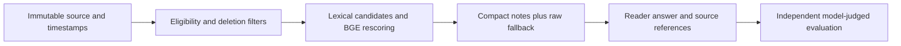

# Chronicle architecture

Immutable sources have namespaces, observed times and tombstones. Eligibility is
applied in SQL before lexical candidate retrieval and BGE bi-encoder rescoring.
The latter is candidate rescoring, not a global dense vector search. M0 packs
recent raw messages, M1 packs ordinary retrieved chunks, and M2 combines extracted
quoted notes and raw chunks into a compact12-row pack when notes are available.
All arms share reader model, hard eligibility and input caps. A separate equal12
row ordinary-retrieval control isolates the obvious count difference.

Extraction sees sources only. Derived notes retain every batch dependency and
cannot predate the latest input observation; a dependency tombstone invalidates
those notes. This conservative batch policy favors eligibility over recall.
Temporal corrections are append-only; as_of and known_at have different meanings.
Logical exclusion does not physically erase stored databases, logs or evidence.
The API reader can still refuse useful evidence or misread a temporal update;
correct eligibility does not imply correct answers.

## Standalone packaging

The package namespace and project CLI are new. Domain execution/verification logic is retained from the measured source commit. Dependencies and assets are self-contained; no sibling checkout or original workstation path is required. See PROVENANCE.json for per-file identity.
